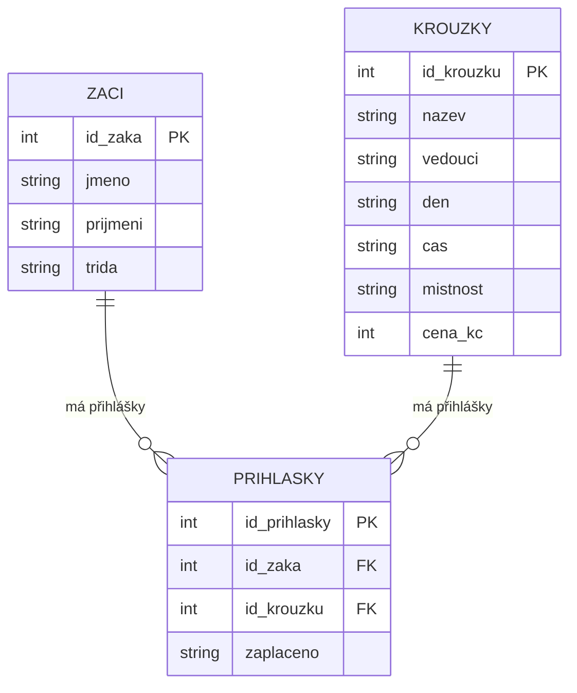

# SP1 Kroužky

Kód žáka: 9

## Věci, které jsou špatně na původní tabulce

1. Nepravidelné formátování
2. Zbytečné opakování některých ůdajů (např. jméno vedoucího (každý kroužek má vždy stejného); lze to rozdělit do více tabulek)
3. Nejde lehce zjistit některé ůdaje (napŕ. kolik kroužků škola nabízí)

## Co je co

* zaci: PK id_zaka
* krouzky: PK id_krouzku
* prihlasky: PK id_prihlasky, FK id_zaka → zaci, FK id_krouzku → krouzky

## ER diagram

## Dotaz SQL

SELECT krouzek, cena FROM krouzky WHERE cena > 500;